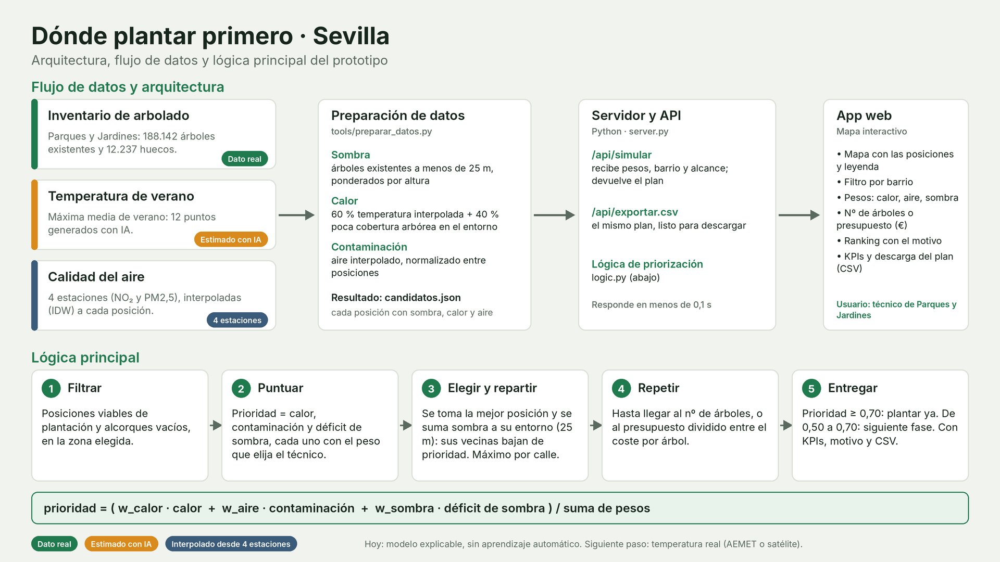

# Dónde plantar primero · Sevilla

App que recomienda al Ayuntamiento de Sevilla **dónde plantar árboles primero**, priorizando las zonas con más calor, más contaminación y menos sombra. Prototipo de la Prueba 1 de Líderes Digitales Universitarios (sede Sevilla).

---

## Cómo iniciar el proyecto

**Necesitas:** Python 3.8 o superior y conexión a internet (el mapa carga su librería y el fondo desde internet). No hay que instalar nada más.

**Opción A: doble clic (la más fácil)**
- **Windows:** doble clic en `iniciar.bat`
- **Mac / Linux:** en una terminal, dentro de esta carpeta: `sh iniciar.sh`

**Opción B: terminal**
```bash
cd dondeplantar
python server.py        # en Mac / Linux: python3 server.py
```

Se abre solo el navegador en **http://localhost:8000**. Si no se abre, escribe esa dirección en el navegador.
Para parar el programa: `Ctrl + C` en la terminal.

**Problemas habituales**
- *"python no se reconoce como un comando"*: instala Python desde python.org (marca "Add Python to PATH") o prueba con `py server.py`.
- *El puerto 8000 está ocupado*: usa otro, por ejemplo `python server.py 8080` y abre http://localhost:8080.
- *Se ve la barra lateral pero el mapa está vacío*: sin internet no carga el mapa. El resto de la app funciona.
- *Aparece "Falta data/candidatos.json"*: mira la sección "Regenerar los datos" más abajo.

**Cómo probarlo en 30 segundos:** pulsa **Ola de calor**, elige un barrio en el desplegable, cambia a **Presupuesto (€)**, escribe `40000` y haz clic en cualquier círculo del mapa para ver por qué se propone.

---

## 1. Usuario objetivo, caso de uso y contexto urbano

**Contexto urbano.** En verano el calor no afecta igual a todos los barrios de Sevilla y hay calles con muy poca sombra. El Ayuntamiento planta con un presupuesto limitado y necesita decidir, y justificar, dónde plantar primero.

**Usuario objetivo.** Técnicos de Parques y Jardines y de Urbanismo del Ayuntamiento, que preparan el plan de plantación, y la concejalía que lo aprueba.

**Caso de uso.** En la campaña de plantación de otoño-invierno, el técnico:
1. Elige un barrio (o toda la ciudad).
2. Ajusta qué pesa más: calor, contaminación o falta de sombra.
3. Indica cuántos árboles puede plantar, o cuánto dinero tiene.
4. Obtiene el plan: posiciones concretas, calle a calle, ordenadas por prioridad y con el motivo de cada una, y lo descarga en CSV.

---

## 2. Arquitectura, flujo de datos y lógica principal



| Capa | Qué hay |
|---|---|
| **Datos y sensores** | Inventario de arbolado del Ayuntamiento (real); 4 estaciones de calidad del aire (NO₂ y PM2,5); temperatura máxima media de verano en 12 puntos (estimada, generada con IA) |
| **Preparación** | `tools/preparar_datos.py` calcula para cada posición viable su sombra, calor y contaminación, y lo guarda en `data/candidatos.json` |
| **API** | `server.py` (Python, sin dependencias): `/api/simular`, `/api/exportar.csv`, `/api/barrios`, `/api/estaciones`, `/api/temperaturas` |
| **Lógica** | `logic.py`: puntuación de prioridad y selección de árboles |
| **App** | Interfaz web con mapa (Leaflet), filtros, ranking, KPIs y descarga del plan |
| **IA** | Hoy un modelo **explicable** (pesos y optimización), sin aprendizaje automático. La temperatura de verano es una estimación generada con IA (ver debilidades) |

**Flujo de datos:** inventario + aire + temperatura → preparación (sombra, calor, aire interpolados) → `candidatos.json` → API → app web.

---

## 3. Prototipo: UI navegable

El prototipo es la propia aplicación web, totalmente navegable e interactiva. Sus controles principales:

- **Zona:** desplegable de barrios (106), con el nº de posiciones candidatas de cada uno.
- **Qué pesa más:** tres deslizadores (calor, contaminación, falta de sombra) y tres escenarios predefinidos: *Ola de calor*, *Calidad del aire* y *Equilibrado*.
- **Cuánto plantar:** por **nº de árboles** o por **presupuesto en euros** (campo de texto). Con presupuesto, nº de árboles = presupuesto ÷ coste por árbol (editable).
- **Máximo por calle:** para que el plan no se concentre en un solo sitio.
- **Mapa:** un círculo por árbol propuesto, con leyenda; se puede mostrar la capa de temperatura y las estaciones de aire.
- **Resultados:** KPIs (árboles, calles, m² de sombra, CO₂, coste), resumen por barrio, las 10 primeras posiciones con su motivo y el botón de descarga del plan completo en CSV.

---

## 4. Lógica simulada (reglas simples y pseudocódigo)

```
para cada posición viable de plantación:
    déficit_sombra = 1 - sombra_de_los_árboles_existentes_a_menos_de_25_m / objetivo
    calor          = 60 % temperatura interpolada + 40 % poca cobertura arbórea en el entorno
    contaminación  = aire interpolado desde 4 estaciones, normalizado entre posiciones
    prioridad = (w_calor·calor + w_aire·contaminación + w_sombra·déficit_sombra) / suma_de_pesos

repetir hasta N árboles (N = nº indicado, o presupuesto ÷ coste por árbol):
    elegir la posición con mayor prioridad (respetando el máximo por calle)
    sumar sombra a las posiciones de alrededor (25 m) -> baja su prioridad
                                   # impacto marginal: el plan se reparte, no se amontona

acción:  prioridad ≥ 0,70 → "Plantar ya"  |  0,50 a 0,70 → "Siguiente fase"  |  resto → "No prioritaria"
```

**Qué cuenta como qué en el inventario** (`TIPO_MARRA`):
- *Árbol existente (da sombra):* campo vacío. Los tocones, árboles muertos y alcorques no dan sombra.
- *Posición candidata:* "Posición VIABLE plantación" (con o sin tocón) y "Alcorque vacío".
- *Excluido:* posiciones no viables, alcorques cerrados o a anular, árboles muertos y los parques periurbanos.

**Demo:** la propia app, ejecutando esta lógica sobre 188.142 árboles existentes y 12.237 posiciones candidatas reales. Cada simulación tarda una fracción de segundo.

---

## 5. Métrica de éxito y debilidad

**Métrica de éxito (la calcula la app).** Frente a plantar sin criterio, es decir, al azar, los sitios que propone son bastante más urgentes según el índice de prioridad. La app lo muestra como *"Prioridad media un X % mayor que elegir posiciones viables al azar"*. Se calcula así: (prioridad media de las posiciones elegidas ÷ prioridad media de todas las posiciones candidatas de la zona − 1) × 100.
Es una medida **interna**: indica que el plan se concentra en las posiciones más prioritarias, no que el efecto real sobre la temperatura sea ese porcentaje.

**Objetivo para un piloto (no calculado por la app).** Que al menos 8 de cada 10 árboles plantados estén en zonas de prioridad alta, y medir después, en esas calles, la sombra y la temperatura reales.

**Debilidades**
- **El calor es una estimación.** La temperatura de verano son 12 puntos generados con IA, no mediciones. Hay que sustituirla por datos de AEMET o de satélite antes de usar la herramienta en decisiones reales.
- **El aire sale de solo 4 estaciones**, interpoladas a toda la ciudad, y varía poco entre ellas: discrimina poco.
- **No se mide el efecto real** de plantar sobre la temperatura ni sobre la salud.
- **Faltan criterios sociales**: población vulnerable, colegios, centros de salud.
- **Los costes y los beneficios por árbol son supuestos** de ejemplo (400 € por árbol, 20 m² de sombra y 20 kg de CO₂ al año por árbol adulto) y habría que contrastarlos con fuentes.

---

## 6. Innovación, sostenibilidad y escalabilidad

**Innovación técnica**
- Parte de las **posiciones realmente viables** del inventario (no de un mapa de calor genérico).
- **Impacto marginal:** cada árbol elegido cambia la prioridad de los vecinos, y el plan se reparte.
- **Explicable:** cada posición propuesta lleva su motivo, y el técnico decide los pesos.
- Combina tres capas (sombra real, calor y aire) y trabaja con **presupuesto en euros**, como decide un ayuntamiento.

**Prueba de concepto.** Funciona con datos reales y a escala de ciudad: filtro por barrio, ranking, mapa, KPIs y plan descargable.

**Sostenibilidad.** Más sombra y menos calor en las calles más expuestas, y mejor calidad del aire. Menos necesidad de aire acondicionado y más adaptación al cambio climático. Las cifras de CO₂ y sombra son estimaciones.

**Escalabilidad.** Otra ciudad es otro conjunto de datos: la lógica no cambia. Se pueden añadir más capas (población vulnerable, colegios, hospitales) como nuevos pesos, y sustituir la temperatura estimada por datos de AEMET o de satélite sin tocar la interfaz.

---

## 7. Datos y supuestos

| Dato | Estado | Detalle |
|---|---|---|
| Inventario de arbolado | **Real** | `Parques_y_Jardines_Inventario_de_Arboles.geojson`: 188.142 árboles existentes y 12.237 posiciones candidatas |
| Sombra | **Calculada** | Árboles existentes a menos de 25 m, ponderados por altura |
| Temperatura de verano | **Estimada con IA** | `data/temperatura_verano.geojson`: 12 puntos, interpolados (IDW) |
| Cobertura arbórea del entorno | **Calculada** | Proxy de calor en ~300 m; pesa el 40 % del calor |
| Calidad del aire | **4 estaciones** | `data/estaciones_aire.csv` (Bermejales, Ranilla, Santa Clara, Torreblanca), interpoladas (IDW). Las coordenadas del original venían con el punto decimal desplazado y se corrigieron; 3 lecturas por estación, promediadas |

Todos los supuestos (objetivo de sombra, umbrales, coste por árbol, etc.) están en `logic.py`, en `SUPUESTOS`, y se ven en la app en *Datos y supuestos*.

---

## 8. Estructura del proyecto

```
iniciar.bat / iniciar.sh   arranque con doble clic
server.py                  servidor y API
logic.py                   prioridad, selección de árboles y supuestos
data/                      candidatos.json (datos ya preparados), estaciones_aire.csv, temperatura_verano.geojson
static/                    interfaz (index.html, app.js, style.css)
docs/arquitectura.png      esquema de arquitectura, flujo de datos y lógica
tools/preparar_datos.py    genera data/candidatos.json a partir del inventario
```

### Regenerar los datos (opcional)
`data/candidatos.json` ya viene preparado, así que no hace falta. Para regenerarlo, copia el inventario completo a `data/arboles.geojson` (unos 95 MB) y ejecuta `python tools/preparar_datos.py` (unos segundos). Después reinicia el servidor.
